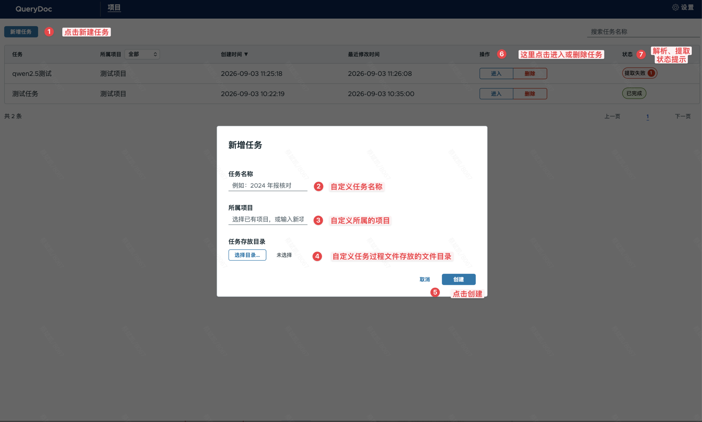
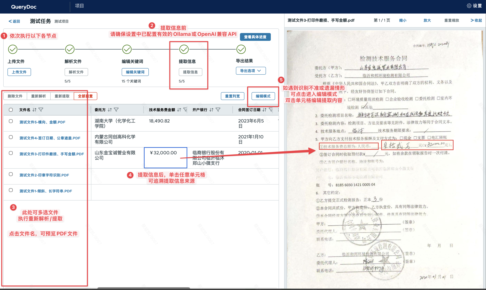
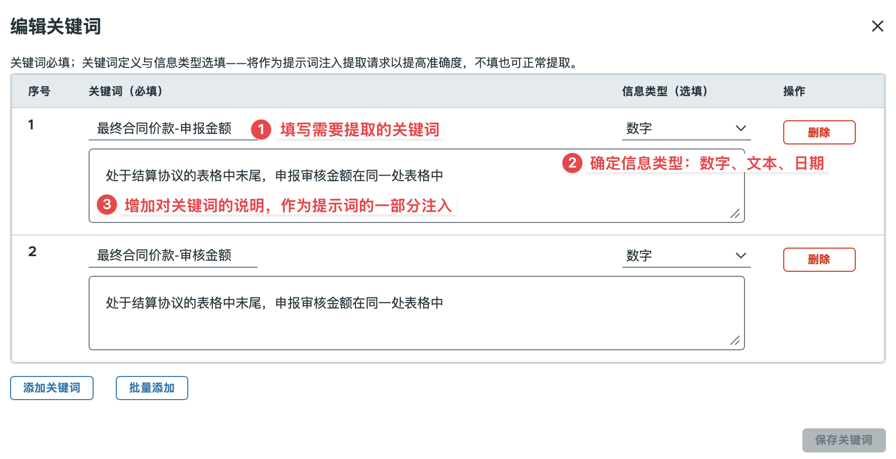
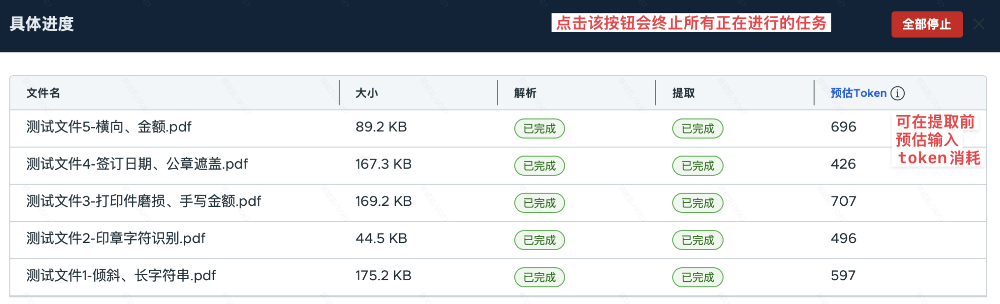
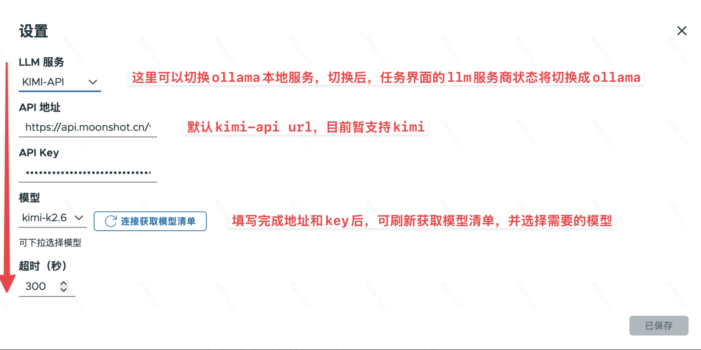

# QueryDoc使用说明

## 新建任务和项目

## 任务窗口基础操作

当解析完成后可以输入需要提取信息的关键词、关键词定义、信息类型。

如遇到提取出错，请点击 查看具体进度，检查具体出错文件的错误信息。同时下方会展示运行日志，检 查具体的运行过程情况，相关日志及 LLM输出json结果，均保留在提取结果集中。

右上角设置可配置LLM源。

## 导出结果
所有过程和结果文件，均在该任务目录下，目前支持以下方式导出： 
- 导出数据表格：即导出提取完成的信息为 xlsx文件。
- 导出附件表格：除xIsx文件同时导出相关pdf文件，采用“HYPERLINK”公式链接。
- 复制表格至剪切板：即将提取完成的信息复制到你剪切板，方便粘贴至各类底稿中。
